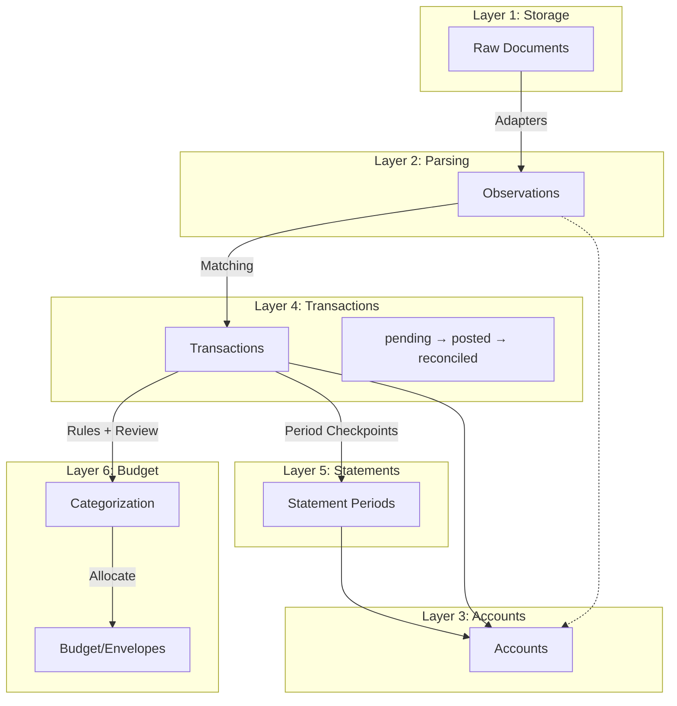

# OpenEnvelope

**Envelope budgeting for the agentic era**

Production-ready personal finance system with authenticated API, onboarding flow, end-to-end browser tests, and S3-compatible encrypted backups.

OpenEnvelope is an open-source, self-hostable budgeting application designed for couples using YNAB-style envelope budgeting. It works with most major consumer banks worldwide through a flexible adapter system, maintaining complete data sovereignty and privacy.

## Features

- 🏦 **Bank-Agnostic**: Works with CSV, OFX/QFX, email alerts, and PDF statements
- 🔒 **Privacy-First**: Self-hosted, all data stays on your infrastructure
- 💑 **Built for Couples**: Separate and shared envelopes for household budgeting
- 📧 **Real-Time Alerts**: Email alert integration for instant pending transactions
- 🔄 **Smart Matching**: Automatic matching of email alerts to posted transactions
- 📊 **Transaction Reconciliation**: Statement periods with balance checkpoints
- 🎯 **Envelope System**: YNAB-style envelope budgeting with monthly allocations
- 🔐 **Secure**: Content-addressed document storage with audit trails
- 🐳 **Easy Deploy**: Single `docker compose up` deployment
- 💾 **Simple Backups**: Lightweight encrypted backups to S3/R2

## Install (one command)

```bash
curl -fsSL https://raw.githubusercontent.com/seahyc/open-envelope/main/install.sh | bash
```

Needs git, Docker (Compose v2) and openssl. It clones the repo, writes a `.env` with fresh random secrets, builds the image and starts it at <http://localhost:3100>. It binds to localhost with no login, so put it behind an auth proxy (Cloudflare Access, Tailscale) before exposing it. Re-run it any time to update.

## Quick Start (manual)

### Prerequisites

- Docker and Docker Compose
- Node.js 20+ (for development)

### Deploy with Docker

1. Clone the repository:

```bash
git clone https://github.com/seahyc/open-envelope.git
cd open-envelope
```

2. Create `.env` file:

```bash
cp .env.example .env
```

3. Generate Age encryption key for backups:

```bash
age-keygen -o age-key.txt
cat age-key.txt  # Copy the public key to BACKUP_AGE_PUBLIC_KEY in .env
```

4. Prepare host directories. The image runs as uid 1000 (`node`). A bind-mounted
   `./backups` directory must be owned by uid 1000, or switch to a named volume:

```bash
mkdir -p data backups
sudo chown 1000:1000 backups
# or in docker-compose.yml use: backups:/backups
```

5. Start the application:

```bash
docker compose up -d
```

6. Access the application at `http://localhost:3100`

### Features

- **Authentication**: Google sign-in and email magic link (sessions); Cloudflare Access JWT remains an optional extra gate for self-hosters
- **Onboarding**: Multi-household first run for any couple (`docs/ux/onboarding-general.md`) — invite partner, bank-agnostic data in, guided envelopes
- **Tenancy**: `household_id` on every tenant table; existing single-household files migrate to tenant `#1` (`hh-1`) with no data rewrite
- **Multi-Source Import**: CSV, OFX, email alerts (RFC822), and PDF statement parsing
- **Bulk Historical Import**: CLI and API for importing entire folder trees of statements
- **LLM-Powered Intelligence**: Optional Codex integration for merchant categorization and unknown format parsing
- **Envelope Budgeting**: Shared and personal envelopes with "ready to assign" workflow
- **Automated Reconciliation**: Statement periods, balance checks, transfer detection
- **Encrypted Backups**: Age-encrypted, zstd-compressed, S3-compatible storage
- **End-to-End Tested**: Playwright browser tests covering full user flows

## Development

```bash
npm install
npm run dev
```

Environment variables (see `.env.example`):
- `APP_MODE=hosted|selfhost`
- `AUTH_MODE=session` (Google + magic link), `header` (Access-only), or `none` (tests)
- `ACCESS_GATE=1` to require a valid Access JWT *and* a session
- `AUTH_HEADER_NAME=X-Auth-User`
- `ALLOWED_EMAILS=alex@example.com,sam@example.com` (Access allowlist / tenant `#1` self-host)
- `CF_ACCESS_TEAM_DOMAIN` and `CF_ACCESS_AUD` for Cloudflare Access
- `GOOGLE_CLIENT_ID` / `GOOGLE_CLIENT_SECRET` for Google sign-in
- `AUTH_SIGNUP=1` required (with `AUTH_MODE=session`) to enable Google / magic-link sign-up; default off
- `AUTH_MAGIC_CAPTURE=1` (dev/test only: magic-link URL in JSON, no SMTP)
- `INGEST_API_KEY` for webhook ingestion
- `DEMO_MODE=true` to load synthetic data on startup
- `LLM_PROVIDER=none|codex|openai` for optional AI features (hosted: app-level key + per-household cap; self-host: bring your own)
- Product spec: `docs/ux/onboarding-general.md`

The server runs on port 3100, and Vite dev server runs on port 5174 with proxy to the API.

## Architecture

OpenEnvelope is built on a six-layer data model that maintains complete traceability from raw bank documents to budget allocations:



### Data Model

1. **Raw Documents**: Immutable, content-hashed (SHA-256) files stored in object storage (S3/R2 or local disk)
2. **Observations**: Normalized transaction data extracted by adapters (CSV, OFX, email, PDF)
3. **Accounts**: Bank accounts with aliases, groups (budget/credit/tracking), and lifecycle dates
4. **Transactions**: State machine (pending → posted → reconciled) with observation traceability
5. **Statement Periods**: Balance checkpoints for reconciliation with discrepancy detection
6. **Budget**: YNAB-style envelopes with Ready to Assign, monthly allocations, and shared/personal ownership

### Key Features

#### Idempotent Imports

Re-importing the same document is a no-op. Documents are content-hashed, and observations are deterministically ID'd from their content.

#### Alert → Statement Matching

1. Email alerts create **pending** transactions immediately
2. Statement imports match pending transactions by amount, date window, and merchant similarity
3. Matched transactions transition to **posted** with both observations linked
4. Holds that never post after 14 days are flagged to review queue
5. FX amounts can change during matching (common for international transactions)

#### Reconciliation

Statement periods capture opening and closing balances. The reconciliation process:
- Sums all posted transactions in the period
- Compares calculated vs. stated closing balance
- Flags discrepancies for review

Every transaction traces back to its source observation(s) and raw document.

## Adapters

OpenEnvelope uses a plugin system for importing transactions from different sources.

### Built-in Adapters

#### CSV Adapter

Generic CSV import with configurable column mapping:

```typescript
{
  accountHint: "1234",      // Last 4 digits or account nickname
  dateColumn: "Date",
  amountColumn: "Amount",
  merchantColumn: "Description",
  referenceColumn: "Reference",  // Optional
  hasHeader: true,
  delimiter: ","
}
```

#### OFX/QFX Adapter

Supports Open Financial Exchange format (most US banks):
- Parses STMTTRN blocks
- Maps TRNTYPE to transaction kinds
- Extracts FITID as reference
- Handles DTPOSTED timestamps

#### Email Alert Adapter

Pattern-based email parsing for transaction alerts:

```typescript
{
  name: "sample-bank",
  fromPattern: "alerts@bank.com",
  subjectPattern: "Card Alert",
  accountHintRegex: "Card ending in (\\d{4})",
  amountRegex: "\\$([\\d,.]+)",
  merchantRegex: "at ([A-Za-z0-9 ]+)",
  dateRegex: "(\\d{2}/\\d{2}/\\d{4})",  // Optional
  kind: "purchase"  // Optional default
}
```

#### PDF Statement Adapter

Regex-based PDF statement parser (requires custom configuration per bank format):

```typescript
{
  accountHintRegex: "Account: (\\d+)",
  transactionRegex: "(\\d{2}/\\d{2})\\s+(.+?)\\s+([-\\d,.]+)",
  dateGroup: 1,
  merchantGroup: 2,
  amountGroup: 3
}
```

### Creating Custom Adapters

Implement the `Adapter` interface:

```typescript
interface Adapter {
  readonly name: string;
  readonly supportedMimeTypes: string[];
  parse(content: Buffer, documentHash: string): Promise<ParsedObservation[]>;
}
```

Example:

```typescript
export class MyBankAdapter implements Adapter {
  readonly name = 'mybank';
  readonly supportedMimeTypes = ['text/csv'];

  async parse(content: Buffer, documentHash: string): Promise<ParsedObservation[]> {
    // Parse your bank's format
    return observations;
  }
}
```

Register your adapter in `src/server/index.ts`:

```typescript
const adapters = [
  new MyBankAdapter(),
  // ... other adapters
];
```

## Deployment

### Docker Compose (Recommended)

The included `docker-compose.yml` provides a complete setup:

```yaml
services:
  openenvelope:
    build: .
    ports:
      - "3100:3100"
    volumes:
      - ./data:/data
      - ./backups:/backups
    environment:
      - AUTH_MODE=header
      - AUTH_HEADER_NAME=X-Auth-User
```

### Free Hosting Option: Oracle Cloud + Cloudflare

Deploy on Oracle Cloud Always Free tier (ARM-based VM):

1. **Provision Oracle Cloud VM**:
   - 1-4 ARM-based cores
   - 6-24 GB RAM
   - Ubuntu 22.04 LTS

2. **Install Docker**:

```bash
curl -fsSL https://get.docker.com -o get-docker.sh
sudo sh get-docker.sh
```

3. **Clone and deploy**:

```bash
git clone https://github.com/seahyc/open-envelope.git
cd open-envelope
cp .env.example .env
# Edit .env with your settings
docker compose up -d
```

4. **Configure Cloudflare Access** for authentication:
   - Add your domain to Cloudflare
   - Go to Zero Trust → Access → Applications
   - Create a new self-hosted application
   - Set "Subdomain" to `budget` (or your choice)
   - Add access policies (email domain, specific users, etc.)
   - In "Advanced Settings", set "Header Name" to `X-Auth-User`

5. **Set up Cloudflare R2** for backups:
   - Create R2 bucket in Cloudflare dashboard
   - Generate R2 API token
   - Update `.env` with S3-compatible R2 credentials
   - Configure lifecycle rule for 30-day retention

### Authentication

OpenEnvelope supports trusted header authentication, designed to work behind reverse-proxy SSO like Cloudflare Access, Authelia, or Authentik.

Set in `.env`:

```bash
AUTH_MODE=header
AUTH_HEADER_NAME=X-Auth-User
```

The header value becomes the user identifier. All operations are scoped to this user.

### Email Alert Ingestion (Optional)

Use Cloudflare Email Routing + Worker to forward bank alerts:

1. **Set up Email Routing** in Cloudflare dashboard:
   - Add your domain
   - Create email address: `banking@yourdomain.com`
   - Route to Worker

2. **Deploy the Worker**:

```bash
cd cloudflare-worker
npm install -g wrangler
wrangler deploy
```

3. **Configure Worker environment variables**:
   - `OPENENVELOPE_INGEST_URL`: Your OpenEnvelope URL
   - `OPENENVELOPE_API_KEY`: Optional API key

4. **Forward alerts**: Set up email forwarding rules in your bank to `banking@yourdomain.com`

## Backup and Restore

### Automated Backups

The included `scripts/backup.sh` script creates encrypted, compressed backups:

1. SQLite `.backup` (consistent snapshot, no downtime)
2. Archive of the local documents directory (`OBJECT_STORAGE_LOCAL_PATH`)
3. Zstd compression
4. Age encryption — `BACKUP_AGE_PUBLIC_KEY` is required (the script exits if unset)
5. Local retention for `BACKUP_RETENTION_DAYS` days (default 7)
6. Optional upload to S3-compatible R2 via the AWS CLI (credentials from env vars only)

The container user is uid 1000 (`node`). If you bind-mount `./backups` from the host,
that directory must be owned by uid 1000. A named Docker volume for `/backups` avoids
the host chown.

Configure in `.env`:

```bash
BACKUP_ENABLED=true
BACKUP_S3_ENDPOINT=https://your-account.r2.cloudflarestorage.com
BACKUP_S3_BUCKET=openenvelope-backups
BACKUP_S3_ACCESS_KEY_ID=your-access-key
BACKUP_S3_SECRET_ACCESS_KEY=your-secret-key
BACKUP_AGE_PUBLIC_KEY=age1...your-public-key
BACKUP_RETENTION_DAYS=7
BACKUP_MAX_BYTES=536870912
```

**Set up cron** (runs daily at 2 AM):

```bash
0 2 * * * /path/to/openenvelope/scripts/backup.sh >> /var/log/openenvelope-backup.log 2>&1
```

### Restore from Backup

```bash
./scripts/restore.sh backups/openenvelope-backup-20240115-120000.tar.zst.age age-key.txt
```

Stop the OpenEnvelope app before restoring (`docker compose stop openenvelope`).
The script detects an open database in two ways: it scans this container's
`/proc` for processes holding the DB/WAL/SHM files, then opens the live DB with
`sqlite3` and runs `PRAGMA locking_mode=EXCLUSIVE; BEGIN EXCLUSIVE; ... COMMIT;`
with a short busy timeout. An idle WAL reader in another container on the same
volume does not conflict with a plain `BEGIN EXCLUSIVE; ROLLBACK;`, but this
exclusive locking-mode probe does.

This will:
1. Decrypt with your Age private key
2. Integrity-check the archive with `zstd -t`
3. Reject archive members with absolute paths, `..`, symlinks, or hard links
4. Require an `openenvelope.db` snapshot inside the archive
5. Run `PRAGMA integrity_check` on the snapshot and abort unless it returns `ok`
6. Stage the database and documents fully, then swap both in one step (WAL/SHM
   sidecars are moved aside with the live DB so they cannot replay onto the snapshot)
7. If anything fails, live files are left untouched or reverted
8. Move any existing database/documents aside as `*.pre-restore.*`

### Bucket Lifecycle Policy

Configure S3/R2 bucket to auto-delete old backups:

**Cloudflare R2**: Go to bucket settings → Lifecycle Rules → Add rule:
- Delete objects after 30 days

**AWS S3**: Use lifecycle configuration:

```json
{
  "Rules": [{
    "Id": "DeleteOldBackups",
    "Status": "Enabled",
    "Expiration": { "Days": 30 }
  }]
}
```

## Security

### No Personal Data in Repository

All fixtures and seeds use synthetic data:
- People: "Alex" and "Sam"
- Addresses: 123 Main St, Anytown, USA
- Cards: 4111-1111-1111-1111 (test card number)
- Merchants: Generic names (Coffee Shop, Grocery Store)
- Amounts: Invented values

### Gitleaks Integration

Automated secret scanning via GitHub Actions:

- Runs on every push and PR
- Configured via `.gitleaks.toml`
- Allows synthetic test data in fixtures/tests
- Blocks commits with real credentials

**Pre-commit hook** (optional):

```bash
pip install pre-commit
pre-commit install
```

This runs gitleaks before each commit.

### Data Encryption

- Backups encrypted with Age (modern alternative to PGP)
- Raw documents content-hashed (SHA-256)
- All database access via prepared statements (SQL injection protection)

## API Reference

### Accounts

- `GET /api/accounts` - List all accounts
- `POST /api/accounts` - Create account

### Import

- `POST /api/import` - Upload document (multipart/form-data)
- `POST /api/process-observations/:accountId` - Process observations into transactions

### Transactions

- `GET /api/transactions` - List transactions (filter by account, state)
- `POST /api/transactions/:id/categorize` - Set category and envelope
- `GET /api/review-queue` - Get flagged transactions

### Budget

- `GET /api/budget/:month` - Get budget for month (YYYY-MM)
- `POST /api/budget/allocate` - Allocate amount to envelope
- `GET /api/envelopes` - List envelopes
- `POST /api/envelopes` - Create envelope

## Development

### Stack

- **Backend**: Node.js, Hono, SQLite (better-sqlite3)
- **Frontend**: React, Vite
- **Type Safety**: TypeScript (strict mode)
- **Testing**: Vitest
- **Validation**: Zod

### Project Structure

```
openenvelope/
├── src/
│   ├── server/
│   │   ├── adapters/       # Import adapters
│   │   ├── db/             # Database schema & init
│   │   ├── services/       # Business logic
│   │   ├── storage/        # Document storage
│   │   └── index.ts        # Hono API server
│   ├── client/
│   │   ├── views/          # React views
│   │   ├── App.tsx         # Main component
│   │   └── main.tsx        # Entry point
│   └── shared/
│       └── types.ts        # Shared types
├── fixtures/               # Synthetic test data
├── scripts/                # Backup/restore scripts
├── cloudflare-worker/      # Email ingestion worker
└── tests/                  # Test files
```

### Running Tests

```bash
npm test
```

Tests use in-memory SQLite databases and synthetic fixtures.

### Code Standards

- Integer cents everywhere (never floats for money)
- All amounts stored as `amount_cents: number`
- Timestamps as Unix epoch milliseconds
- Content-addressable storage (SHA-256 hashes)
- Idempotent operations (re-running is safe)

## Roadmap

- [ ] Transfer detection and automatic linking
- [ ] Scheduled transactions (recurring bills)
- [ ] Multi-currency support with exchange rates
- [ ] Mobile app (React Native)
- [ ] Bank API integrations (Plaid, Teller)
- [ ] Budget reports and analytics
- [ ] Goals and savings targets
- [ ] CSV export for tax prep
- [ ] Reconciliation workflows
- [ ] Multi-user with permissions

## Contributing

Contributions are welcome! Please:

1. Use synthetic data in all tests and fixtures
2. Run `npm test` before submitting
3. Follow the existing code style
4. Update documentation for new features

## License

MIT License - see [LICENSE](LICENSE) file for details.

## Acknowledgments

Inspired by YNAB's envelope budgeting methodology. Built for the agentic era with AI-first design principles: comprehensive documentation, strong typing, idempotent operations, and extensive test coverage.

## Support

- Issues: [GitHub Issues](https://github.com/seahyc/open-envelope/issues)
- Discussions: [GitHub Discussions](https://github.com/seahyc/open-envelope/discussions)

---

Made with ❤️ for couples who budget together
