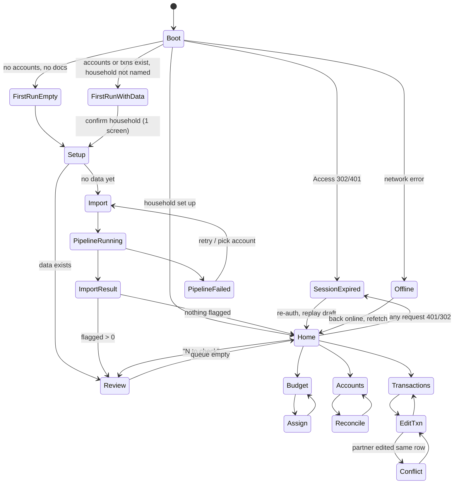
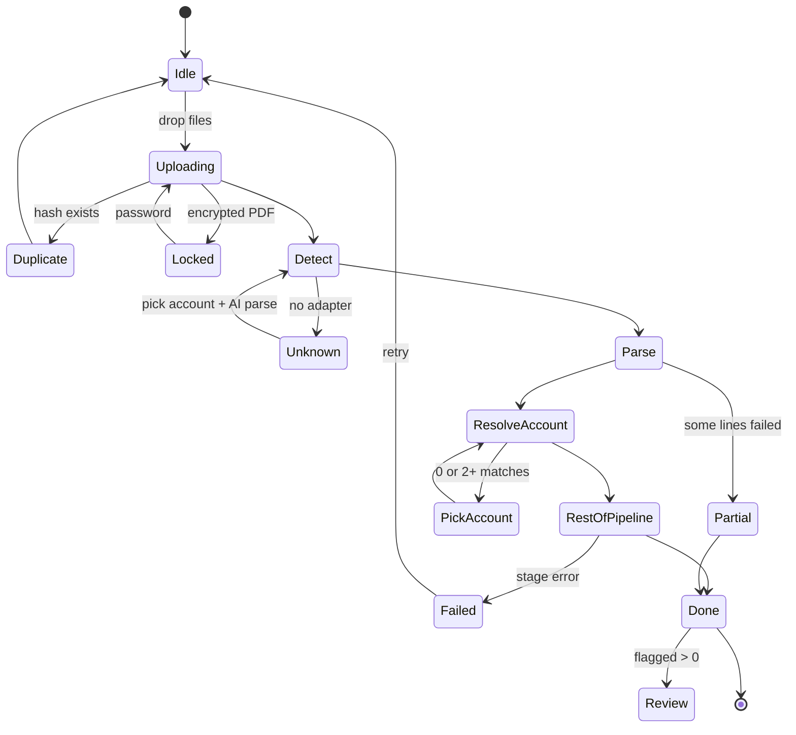
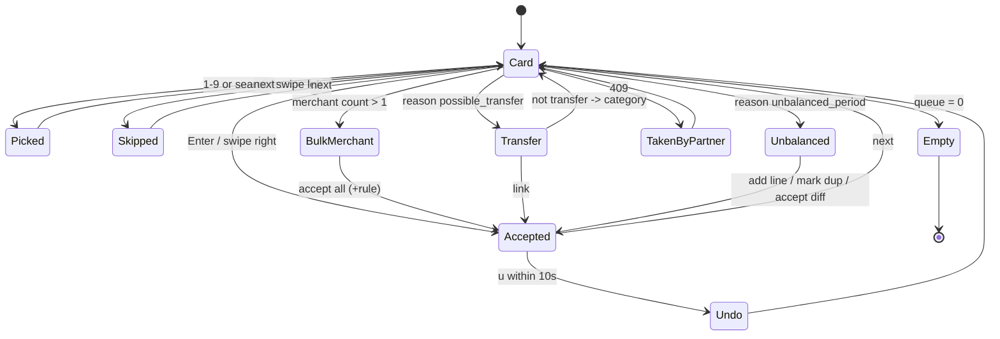
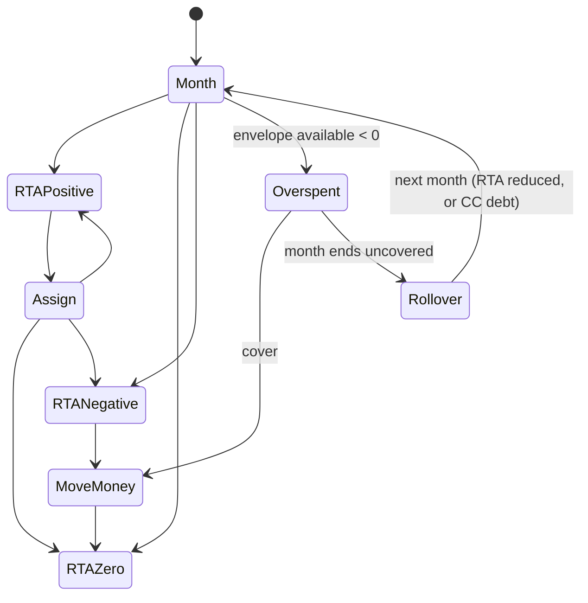
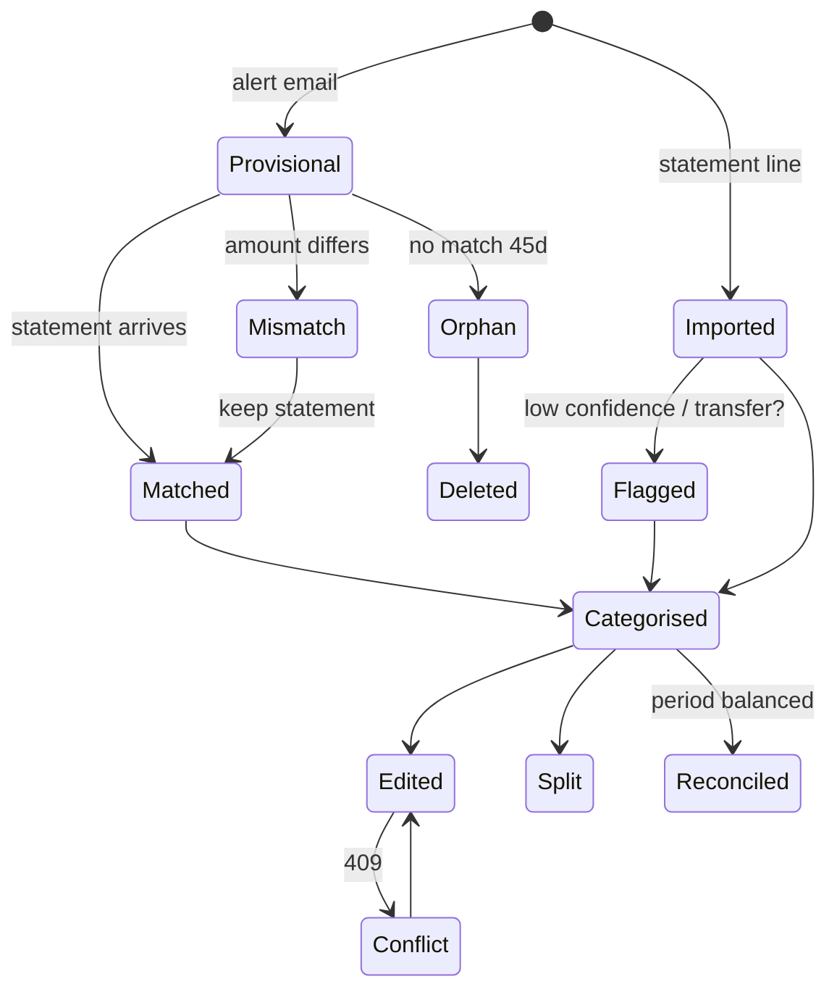
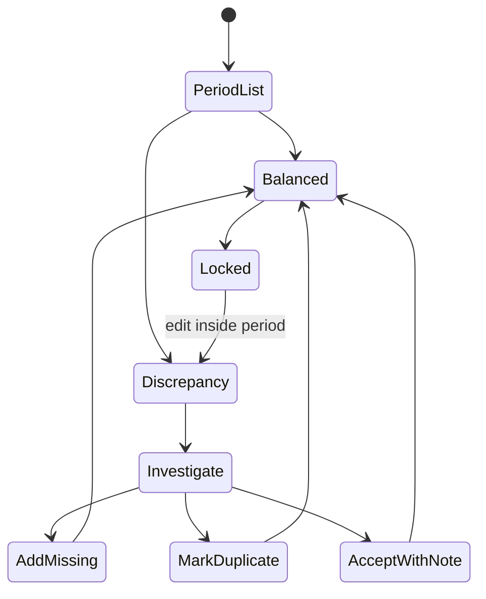

# OpenEnvelope — user journey map

Source read: `ying-cong-seah/openenvelope@main` (remote, Cursor Origin). Files referenced: `src/server/index.ts`, `src/server/services/{onboarding,budget,transaction,transfer,reconciliation,pipeline,import}-service.ts`, `src/server/db/schema.ts`, `src/server/pipeline/definition.ts`, `src/client/App.tsx`, `src/client/views/*.tsx`.
All examples below are made up (Kopi Corner, FairMart, S$4.80 …).

**First run for any couple** (sign-up, invite, tenant boundary, P1/P2 wizards) lives in `docs/ux/onboarding-general.md` (states G-01…G-99). This file keeps the daily driver after a household is live. S-02, S-03, S-10, S-11 are superseded there for multi-household.

## Actors
- **Alex (owner).** Funds the one household budget. Uploads statements, reviews, assigns. Desktop Safari at night, iPhone Safari on the go.
- **Sam (partner).** Mostly mobile. Checks "can we spend on X?", fixes categories she knows best. Never uploads PDFs.
- **The pipeline (system).** ingest → detect-format → parse → resolve-account → upsert → match → reconcile → detect-transfers → categorize (memory → rules → provider → threshold) → flag-rules → review-queue.
- **Email alerts (system).** Cloudflare worker posts bank alert emails to `/api/ingest/email` → provisional transactions before the statement arrives.

## What the code actually does today (ground truth)
| Area | Today | Consequence for UX |
|---|---|---|
| Onboarding gate | `isOnboarded()` = `COUNT(accounts) > 0`; App shows `OnboardingView` when false; `.catch(() => setOnboarded(true))` | Fragile gate; a network error silently skips onboarding. Being fixed by another agent. |
| Starting balance | Onboarding inserts a `Starting Balance` txn with currency **`USD`**, state `reconciled` | Wrong currency; no UI to set starting balances after onboarding. |
| Default envelopes | Hard-coded Groceries/Rent/Utilities/Transportation/Entertainment + "<name>'s Personal" | Does not match the L1–L4 category tree in `config/categories.default.json`; per-person envelopes contradict "one household budget". |
| Navigation | Tabs: Accounts, Import, Transactions, Budget, Pipeline. `tabFromPath` only knows `/` and `/pipeline` | Refresh always lands on Accounts. `ReconcileView` exists but is **not routed**. No deep links. |
| Review queue | `GET /api/review-queue` joins `observations` (not transactions), unresolved only. **No resolve/accept endpoint for queue items**; `/api/transactions/:id/resolve` only nulls `notes` | ~190 items cannot actually be cleared from the UI. No bulk, no same-merchant accept. |
| Categorise | `POST /api/transactions/:id/categorize {category, envelopeId}` + `rememberLabel` | Single-row only; good base for bulk. |
| Transactions list | `LIMIT 100`, no paging/filter/search, no edit/split/delete | 1,000 rows → 90% invisible. |
| Budget | RTA = this month's `category='income'` inflows − this month's allocations. Envelope available = cumulative allocations − cumulative outflows | RTA ignores prior months' leftover/overassign (no carry-forward); overspending isn't deducted from next month's RTA (YNAB rule); no credit-card payment envelopes; `allocate` **adds** (no set/undo). |
| Reconcile | Periods have `status` (`balanced`…), `discrepancy_cents`; POST to reconcile a period | No UI path to it; no discrepancy drill-down. |
| Transfers | `GET /api/transfers`, `POST /api/transfers/detect` | Only via review reason `possible_transfer`; no confirm/reject UI. |
| Concurrency | No `updated_at` checks on writes | Last write wins silently between Alex and Sam. |
| Auth | Cloudflare Access in front; `lib/auth.ts` | `fetch` gets a 302/HTML login page on expiry → views show JSON parse failures or "Loading..." forever. |
| Errors/loading | Views show "Loading..." text; ImportView logs errors to console; others ignore failures | No error, offline, or stale states anywhere. |

## Top-level states

## State catalogue
Format: **Sees / Wants / Primary / Secondary / Exits**. IDs (S-xx) are referenced by `screens.md`.

### A. Boot, session, network
- **S-01 Boot loading.** Sees: pixel mascot blinking + `loading…` (only after 300 ms). Wants: app. Primary: none. Exits: S-02..S-05, S-90.
- **S-02 First run, empty DB.** Sees: "Hi. Nothing here yet. Charlie's envelope is empty." Wants: start. Primary: `[ set up household ]`. Secondary: `load demo` (only if `NODE_ENV!=production`). Exits: S-10.
- **S-03 First run, data already imported** (prod case: 6 accounts, ~1,000 txns). Sees: "Found 6 accounts and 1,0xx transactions from Mar–Sep. 190 need a look." Wants: skip setup, get to work. Primary: `[ confirm household → ]` (names + emails prefilled from Access identity). Secondary: `skip for now` (go Home, banner persists). Exits: S-20 Review, S-30 Home.
- **S-90 Session expired (Cloudflare Access).** Detect: any `/api/*` returning 401/403, a redirect, or `text/html`. Sees: modal "Your session napped. Sign in again." Unsaved draft kept in `sessionStorage`. Primary: `[ sign in ]` (full-page nav to current URL). Exits: back to same view, replay draft with confirmation.
- **S-91 Offline.** Sees: top strip `[ offline · showing 14:02 data ]`, writes disabled (buttons dimmed with reason). Wants: read balances. Primary: none; auto-retry. Exits: online → refetch → toast "back".
- **S-92 Stale.** Data older than 5 min on tab focus, or another device wrote (poll `/api/changes?since=`). Sees: strip `[ updated by Sam · refresh ]`. Primary: refresh. Exits: S-current.
- **S-93 Server error.** Sees: inline card "Something broke on our side (500). Nothing was saved." Primary: `retry`. Secondary: `copy error`. Exits: retry.

### B. Household & partner
- **S-10 Household setup.** Fields: your name, partner name (optional), currency (SGD, locked default), month start (1st). No account creation here when accounts exist. Primary: `[ done ]`. Exits: S-11 or S-20/S-30.
- **S-11 Add partner later.** Settings → Household → `+ add partner` (name, email that Access allows). Sees afterwards: partner initials on edits. Exits: settings.
- Assumption: one budget, no per-person envelopes. `owner` column becomes `shared` for all; "Sam's fun money" is just an envelope.

### C. Import
- **S-12 Import idle.** Drop zone `[ drop statement PDFs ]`, multi-file. Last 5 uploads listed. Exits: S-13.
- **S-13 Uploading/pipeline running.** Per file: stage ticker `ingest ▸ detect ▸ parse ▸ account ▸ upsert ▸ match ▸ reconcile ▸ transfers ▸ categorise ▸ flags ▸ queue` with bracket bar. Wants: know it's working. Secondary: `see pipeline` (→ /pipeline). Exits: S-14..S-19.
- **S-14 Success.** "DBS card · Aug: 84 lines, 81 new, 3 matched alerts. Balanced. 12 to check." Primary: `[ review 12 ]`. Exits: S-20.
- **S-15 Partial parse.** Some lines failed or LLM fallback used. Sees: "Parsed 40 of 43. 3 lines need you." Lines listed with raw text. Primary: `[ fix 3 lines ]` (manual entry prefilled). Secondary: `ignore`. Period likely unbalanced → S-24.
- **S-16 Unknown format.** No adapter matched and fallback refused. Sees: "Don't know this bank layout yet." Primary: `[ pick account & try AI parse ]`. Secondary: `see ADDING_A_BANK`. Exits: S-13 or S-12.
- **S-17 Duplicate upload.** Same `raw_documents.hash`. Sees: "Already have this one (uploaded 3 Sep). Nothing changed." Primary: `ok`. No error tone.
- **S-18 Wrong / ambiguous account.** resolve-account found no alias or two candidates. Sees: account picker with last-4 digits shown. Primary: `[ use OCBC 360 ]`; secondary `+ new account`. Picking adds alias. Exits: S-13 resume.
- **S-19 Password-protected PDF.** Sees: "This PDF is locked. Banks usually use your NRIC + DOB." Input (type=password, never stored) → retry. Secondary: `cancel`. Exits: S-13.
- **S-19b Pipeline failed.** Stage name + plain message + `retry` + `open pipeline view` (node highlighted red-outline, not colour-only: `✕ parse`).

### D. Review (the daily driver)
Queue item = transaction + reason. Order: unbalanced_period first (blocks trust), then possible_transfer, then low_confidence_category grouped by merchant.
- **S-20 Review card.** One card, big merchant, amount, date, account; guess `Food ▸ Hawker` with confidence `[████░░] 62%`. Keys: `Enter` accept, `1–9` pick suggestion, `/` search category, `j/k` next/prev, `s` skip, `u` undo, `t` mark transfer. Mobile: swipe right accept, left skip, tap category chips. Counter `12 / 190`.
- **S-21 Same-merchant bulk.** When the merchant appears >1 in queue: "Kopi Corner ×23 · all → Food ▸ Hawker? `[ accept all 23 ]`" plus `and always` toggle (writes merchant rule). Undo toast 10 s.
- **S-22 List/bulk mode (desktop).** Table, shift-click / `x` select, `c` set category for selection. Filter by reason/account/merchant.
- **S-23 Possible transfer.** Shows both legs side by side: `-S$500.00 OCBC 360 ↔ +S$500.00 DBS card`. Primary `[ link as transfer ]`; secondary `not a transfer` (→ category card), `pick other leg`. Credit-card payment links set the CC payment envelope movement.
- **S-24 Unbalanced period.** "OCBC 360 · Jul: statement says S$4,210.33, we add up to S$4,190.33. Off by S$20.00." Shows candidates (missing line ≈ S$20, duplicates). Primary `[ add missing line ]`; secondary `mark duplicate`, `accept discrepancy (note)`. Exits: balanced → next card.
- **S-25 Queue empty.** Mascot thumbs-up: "Nothing to check. Charlie approves." Primary `go budget`.
- **S-26 Review conflict.** Partner already resolved this item → card slides away, toast "Sam did this one".

### E. Accounts, starting balances, reconcile
- **S-30 Home.** One big number: **Ready to Assign**. Mascot under it. Line: `overspent: 2 envelopes` / `12 to check`. Bottom tabs.
- **S-31 Accounts list.** Groups: Budget (cash), Credit cards, Tracking (CPF/SRS). Per account: cleared balance, last statement month, period status `[balanced]`/`[off S$20.00]`.
- **S-32 Set starting balance.** Account → `starting balance` (date + amount, SGD). Default suggestion = opening balance of earliest statement period. Writes a `reconciled` starting-balance txn in SGD; if one exists, edit it. Inflow to cash accounts goes to RTA; CC starting debt creates a CC payment envelope underfunded.
- **S-33 Reconcile period list.** Per account, months with status. Primary on an off one → S-24.
- **S-34 Reconciled/balanced.** Period lock icon; edits to txns in it ask "this period is balanced; editing will unbalance it".

### F. Budget
- **S-40 Budget month.** Header `< Oct 2026 >`, RTA big number, envelope rows grouped by L1 (category groups). Row: name, assigned, activity, available, bracket bar of available vs target.
- **S-41 RTA positive.** "S$1,240.00 to assign. Give every dollar a job." Primary `[ assign ]` → quick-assign menu (underfunded, last month's assigned, targets).
- **S-42 RTA zero.** "Every dollar has a job." Mascot calm. No primary.
- **S-43 RTA negative (overassigned).** Number shown as `−S$120.00` with the word **over** and inverted block. Primary `fix: take from…` picker.
- **S-44 Envelope overspent.** Row available `−S$32.40 OVER`; tap → "Cover from…" envelope picker. Unresolved at month end: cash overspend is subtracted from next month's RTA; CC overspend becomes CC debt (YNAB rules).
- **S-45 Credit-card payment envelope.** Auto envelope per credit account. Spending on card from a funded envelope moves that amount into the payment envelope. Row shows `pay S$812.30` vs card balance. Paying the card (transfer) drains it.
- **S-46 Month rollover.** First open in new month: toast "October started. Leftovers rolled over; S$0 to assign until income lands." Envelope available carries; RTA carries forward (requires change).
- **S-47 Assign editor.** Inline number field; typed value **sets** assigned (not adds); `+`/`-` buttons for steps; arithmetic allowed (`=200+50`).
- **S-48 Empty budget.** No envelopes: "No envelopes. Start from your categories?" `[ create from categories ]` (seeds L2 envelopes from category tree).

### G. Transactions
- **S-50 Ledger.** Infinite list, search, filters (account, envelope, state, month, needs-review). Provisional (alert) rows marked `~` and "pending statement".
- **S-51 Alert arrives before statement.** Provisional txn from email (state `provisional`), categorised by memory; counts toward envelopes immediately.
- **S-52 Statement matches alert.** Match stage merges; row loses `~`, gains `✓ matched`. If amount differs (FX, tips): review card "Alert said S$18.20, statement says S$19.10. Keep statement?".
- **S-53 Alert never matched** (>45 days). Review card "No statement line for this alert. Delete?".
- **S-54 Edit transaction.** Sheet: date, payee, amount (disabled when statement-sourced; editable for manual), category, memo. Save shows diff.
- **S-55 Split.** `split` → rows of category+amount; remainder shown live `[left: S$12.00]`; save disabled until zero.
- **S-56 Delete.** Statement-sourced: not allowed (explain: it'll come back on next import) → offer `hide/void`. Manual/provisional: delete with undo toast.
- **S-57 Concurrent edit.** Save sends `updated_at`; server 409 → modal showing "Sam changed category to Groceries 2 min ago. Keep hers / Use mine".

### H. Pipeline viewer (/pipeline)
- **S-60 Graph idle/running/failed.** React Flow graph; node counts; failed node `✕` outlined. Advanced; reachable from Settings and import errors, not a tab.

## Flow diagrams

### Import

### Review

### Budget

### Transaction lifecycle

### Reconcile

## Universal view states (apply to every view)
| State | Rule |
|---|---|
| Loading | Skeleton rows in `░` after 300 ms; never a bare "Loading...". |
| Empty | Mascot + one deadpan sentence + one primary action. |
| Error | Inline card with status, "nothing was saved" when true, `retry`. |
| Offline | Top strip, writes disabled with reason, reads from last cache. |
| Stale | Strip "updated by <name> · refresh". |
| Session expired | S-90 modal, draft preserved. |

## States the current code does NOT handle
| # | State | Severity | File(s) to change |
|---|---|---|---|
| 1 | Clearing review items (no resolve endpoint for `review_queue`; client "resolve" only nulls `notes`) | **Critical** | `src/server/index.ts`, new `review-service.ts`, `src/client/views/TransactionsView.tsx` |
| 2 | Bulk / same-merchant accept + keyboard review | **Critical** | `index.ts` (`POST /api/review/bulk`), `categoriser/memory.ts`, new `ReviewView.tsx` |
| 3 | First run with existing data (gate = accounts count; catch → onboarded) | **Critical** (being fixed) | `onboarding-service.ts`, `App.tsx` |
| 4 | CSS never compiled (Tailwind classes) | **Critical** (being fixed) | `OnboardingView.tsx`, `styles.css`, `vite.config.ts` |
| 5 | Transactions beyond 100 / search / filter / paging | High | `index.ts` `GET /api/transactions`, `TransactionsView.tsx` |
| 6 | RTA carry-forward, overspend deducted next month | High | `budget-service.ts` |
| 7 | Assign = set (currently adds), move money between envelopes | High | `budget-service.ts`, `index.ts`, `BudgetView.tsx` |
| 8 | Credit-card payment envelopes | High | `budget-service.ts`, `schema.ts`/`migrations.ts`, `BudgetView.tsx` |
| 9 | Reconcile view unreachable; discrepancy drill-down | High | `App.tsx`, `ReconcileView.tsx`, `reconciliation-service.ts` |
| 10 | Session expiry (HTML/302 from Access parsed as JSON) | High | new `src/client/api.ts`, all views |
| 11 | Starting balance in USD, not editable post-onboarding | High | `onboarding-service.ts`, `AccountsView.tsx`, `index.ts` |
| 12 | Import outcomes: duplicate, locked PDF, unknown format, wrong account as distinct UI | High | `import-service.ts`, `pdf-adapter.ts`, `ImportView.tsx` |
| 13 | Possible-transfer confirm/reject UI | Medium | `transfer-service.ts`, `index.ts`, `ReviewView.tsx` |
| 14 | Edit / split / delete transaction | Medium | `transaction-service.ts`, `schema.ts` (splits table), `TransactionsView.tsx` |
| 15 | Concurrent edits (no optimistic locking) | Medium | `index.ts` write routes (`If-Match: updated_at`) |
| 16 | Alert→statement amount mismatch & orphan alerts surfaced | Medium | `pipeline-service.ts` (match), review reasons |
| 17 | Error / offline / stale states | Medium | `src/client/api.ts`, every view |
| 18 | Routing/deep links (`tabFromPath` only `/pipeline`) | Medium | `App.tsx` |
| 19 | Envelopes not derived from L1–L4 categories; per-person envelopes | Medium | `onboarding-service.ts`, `budget-service.ts` |
| 20 | Month rollover notice | Low | `BudgetView.tsx` |
| 21 | Add partner after setup | Low | new Settings view, `index.ts` |

## Assumptions
- Envelopes map to L2 categories by default ("Food ▸ Hawker" spends from envelope "Food"); L3/L4 are reporting detail. One envelope can own many categories.
- Income = categories under L1 `Income`; inflows to budget accounts land in RTA.
- Tracking accounts (CPF, SRS) are off-budget: shown in Accounts, never in RTA.
- Alert-sourced rows count against envelopes immediately (better for daily use) and are replaced when matched.
- Statement-sourced amounts are immutable; category/memo/split are editable.
- Partner identity comes from Cloudflare Access email header.
