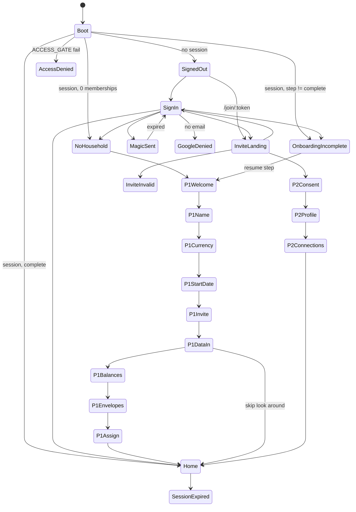
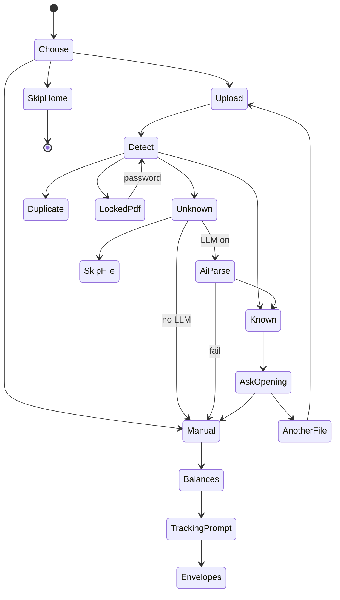
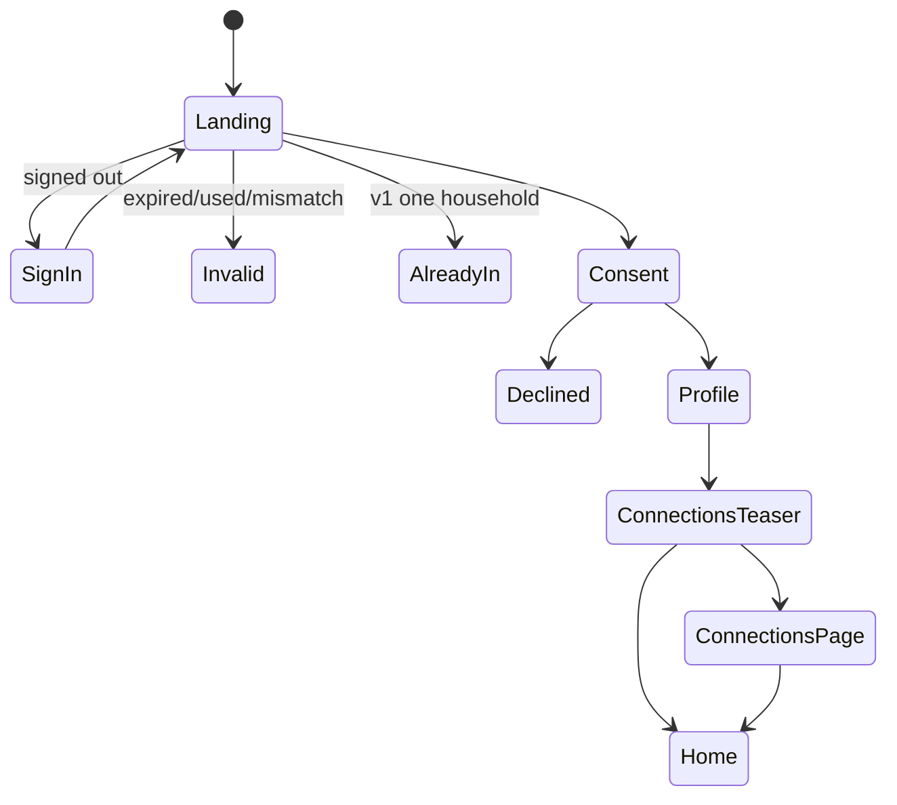

# OpenEnvelope — general onboarding (any couple)

Source of truth for **first run, auth, tenancy, and invite** now that OpenEnvelope is a product any couple can use, not a single-household Cloudflare Access allowlist.

Daily-driver states after a household is live stay in `docs/ux/journey-map.md` (S-01…S-93). First-run states **G-01…G-99** in this file supersede journey-map S-02, S-03, S-10, S-11 for multi-household. Wireframes for G-states live in `docs/ux/screens.md` § Onboarding (general). Context signals / Connections sit **on top of** this tenancy model (`docs/ux/context-signals.md`).

All examples below are made up (Kopi Corner, FairMart, S$4.80, `alex@example.test`). Synthetic fixtures only.

## Why this exists

The first household is tenant **#1**. The next couple to open the app must get an excellent first run without borrowing that data, that Access allowlist, or that Codex/ChatGPT plan. Onboarding is the product.

## Actors
- **Partner 1 (P1).** Creates the household. Names it, picks currency, invites P2, uploads the first statement or types a starting balance. Owns their profile and their Connections.
- **Partner 2 (P2).** Arrives via invite link or email. Joins the existing household. Own profile, own Connections. Sees the shared budget. Cannot see P1's location trail, calendar feed, or receipt mailbox.
- **The household (tenant).** The isolation boundary. One shared budget. Optional later: private 'personal' envelopes that the other partner cannot open.
- **The pipeline (system).** Unchanged stages. Every row it writes is stamped `household_id`.
- **Hosted operator vs self-hoster.** Hosted mode uses an app-level LLM key with per-household limits. Self-hosters bring their own key (or none). Cloudflare Access is an optional extra gate for self-hosters, not the only lock.

## What the code actually does today (ground truth)

| Area | Today | Consequence |
|---|---|---|
| Tenant | One SQLite file = one household. No `household_id`. Connections spec says "implicit household #1". | A second couple cannot use the same app. |
| Onboarding gate | `isOnboarded()` = accounts **or** members exist. App shows two-step names + one account. Starting balance inserted as **USD**. | Fragile; wrong currency; no resume; no invite; no skip. |
| Auth | `AUTH_MODE=header` (Cloudflare Access JWT + `ALLOWED_EMAILS`) or `none` (tests). `mapEmailToMember` hard-maps first two allowlist emails to `alex`/`sam`. | New couples cannot sign up. Access is the product, not an extra gate. |
| Identity | `resolveCurrentMember` picks first member when anonymous. | P2 cannot have their own Connections. |
| LLM | Process env `LLM_PROVIDER=codex\|openai\|none`. the operator's personal Codex/ChatGPT. | Cannot serve other users. No per-household limit. No fallback story in the UI. |
| Data in | Import UI exists; unknown format is a pipeline error, not a first-run path. Starting balances not asked after onboarding. | Bank-agnostic claim is not the first-run experience. |
| Delete / export | None. | GDPR / "we broke up" / "we're leaving" has no door. |

## Deployment modes

| | **Hosted** (`APP_MODE=hosted`) | **Self-host** (`APP_MODE=selfhost`) |
|---|---|---|
| Auth | Google sign-in + email magic link. Sessions (httpOnly cookie). | Same, **or** Access-only (`AUTH_MODE=header`) if the operator does not want public sign-up. |
| Access | Optional. If `CF_ACCESS_*` set, JWT is an extra allow-gate **in front of** sessions (fail closed, existing verifier). | Optional extra gate for operators who already run Access. Bypass paths for OwnTracks / email ingest unchanged. |
| Sign-up | Open (rate-limited). P1 creates a household. | Open unless `AUTH_MODE=header`, in which case the Access allowlist **is** the user directory and first successful JWT creates P1. |
| LLM | App-level key. Per-household daily cap. UI: "categoriser is thinking" / "limit reached, using rules". | Operator pastes their own key or signs into Codex. No key → merchant memory + rules only. |
| Data | One process, many `household_id`s, one SQLite (or later one DB per region). | Typically one household per deploy; tenancy still required so a backup restore cannot mix with another couple's file, and so the same binary can host friends. |
| Connections ingest | Hosted ingest domain + HMAC. Mailbox local-part globally unique. | Operator sets `EMAIL_INGEST_DOMAIN`. Same uniqueness. |

`AUTH_MODE=none` remains tests/dev only and is rejected in production (existing `assertProductionAuthConfig`).

## Tenant model

**Household = tenant.** Every financial, PII, and member-owned row carries `household_id`. Queries always include `WHERE household_id = ?` from the session. Cross-household joins are a bug.

### Tables

**Tenant-scoped (must carry `household_id`):**
`households` (the tenant row), `household_members`, `household_invites`, `onboarding_progress` (or columns on `households`), `accounts`, `transactions`, `envelopes`, `budget_allocations`, `raw_documents`, `observations`, `statement_periods`, `merchant_rules`, `merchant_memory`, `merchant_normalizations`, `category_exemplars`, `adapter_configs`, `review_queue`, `review_undos`, `pipeline_runs`, `stage_runs`, `location_devices`, `location_points`, `place_visits`, `member_calendar_feeds`, `calendar_events`, `orders`, `order_items`, `context_links`, `spent_attributions`, `ingest_mailboxes`, `inbound_mail`, `extension_tokens`, `ingest_hooks`, `ingest_hook_events`, `push_subscriptions`, `users` membership (via `household_members.user_id`), `sessions` (bound to a user + current household).

**Shared reference caches (public data, no PII):**
`schema_migrations`, `geocode_cache` (Nominatim place names), `merchant_enrichments` (ACRA / public registry). These stay global. They never store amounts, emails, or coordinates.

**Auth globals:**
`users` (email unique globally), `magic_link_tokens`, `oauth_accounts`. A user may belong to **one** household in v1 (join = accept invite; leaving = export + delete membership). v2 may allow one user in two households; do not design against it, but do not build it now.

### Isolation rules
1. Session → `user_id` → `household_members.household_id`. Missing membership → 403, never an empty leak of tenant #1.
2. Ingest (email / OwnTracks / extension / webhooks) resolves a **globally unique** secret (mailbox local-part, device id, token) → member → household. No Access JWT on Bypass paths (unchanged).
3. Document blobs are content-addressed. `raw_documents.hash` stays the PK of the blob. Each household still has its own `raw_documents` **row** (`UNIQUE(household_id, hash)` after rebuild) so household B cannot list household A's uploads. Identical bytes may share the object-store key; metadata and observations never do.
4. `UNIQUE(name)` on members becomes `UNIQUE(household_id, name)`. Two couples may both have an Alex.
5. Ready to Assign, envelope maths, ledger paging — **unchanged**. Tenancy wraps queries; it does not change formulas.

### Migration: existing DB → tenant #1

The live single-household file becomes household id **`hh-1`**.

1. `CREATE TABLE households`. Insert `hh-1` with name `Household`, currency `SGD`, `onboarding_step = 'complete'` if accounts or members already exist, else `'welcome'`.
2. `ALTER TABLE … ADD COLUMN household_id TEXT NOT NULL DEFAULT 'hh-1'` on every tenant table. Existing rows keep every other column byte-for-byte.
3. Rebuild only tables whose UNIQUE/PK would block a second household (`household_members`, `merchant_normalizations`, `merchant_memory`, `orders`, `adapter_configs`, `raw_documents`). Copy columns; do not rewrite amounts, timestamps, hashes, or statuses.
4. Backfill `households.budget_start_date` from the earliest `accounts.opened_at` / starting-balance txn if present; else null (onboarding will ask).
5. **Invariant: 1018/1018 still balanced.** After migrate, `COUNT(transactions)` and `COUNT(observations WHERE is_statement = 1)` are unchanged, every `statement_periods.status` is unchanged (the production file's 1018 posted lines / 1018 statement observations stay balanced), Ready to Assign for the current month is unchanged, document hashes are unchanged. Tests seed a synthetic 1018/1018 fixture and assert the checksum. Never invent a missing starting balance during migrate.

Zero data change means: no category rewritten, no USD→SGD conversion of historical starting-balance rows (that bug is a later fix, not this migration), no envelope rename.

## Auth

### Modes (`AUTH_MODE`)
- `none` — tests. Identity `anonymous`. Household `hh-1` if it exists, else first-run with no user.
- `header` — today's Cloudflare Access JWT. Optional extra gate **or** the sole lock for Access-only self-hosters. Verifier stays fail-closed (`Cf-Access-Jwt-Assertion`, RS256, aud/iss/exp/allowlist). Do not regress SHA `70d40b6888b2fb72bb2673489c5d47289eac7d41`.
- `session` — Google + magic link. Default for hosted and for self-hosters who want sign-up.

`ACCESS_GATE=1` + `session`: request must present a valid Access JWT **and** a session cookie. Self-hosters who put Access in front of the origin keep today's topology.

### Sign-up / sign-in (G-10…G-19)
- **Google.** OAuth 2.0 auth-code. Scopes: `openid email profile`. Create/find `users` by email. Set session cookie.
- **Magic link.** `POST /api/auth/magic-link { email }`. Always returns 202 with the same body ("check your email") whether or not the address exists (no user enumeration). Token 15 min, single use, hashed at rest. Dev/test: `AUTH_MAGIC_CAPTURE=1` returns the URL in JSON so Playwright can complete the hop without SMTP. Hosted/self-host: SMTP or a provider the operator configures. Never log the raw token.
- **Session.** `oe_session` httpOnly, Secure (production), SameSite=Lax, 30 day sliding. Server table `sessions(id, user_id, household_id, token_hash, expires_at, created_at, last_seen_at)`. Logout deletes the row.
- **Unverified Access-only path.** First JWT for an unknown email, `AUTH_MODE=header`, no household → treat as P1 first run (create user + wait for household). Second allowlisted email on an existing `hh-1` with no P2 → offer "join this household?" only if P1 has an open invite matching that email; otherwise they get their own household (do not auto-join tenant #1).

### Invites
- P1 generates a link `/join/:token` (48 h, single household, optional email lock). Email send is skip-able.
- P2 must sign in (Google or magic) as themselves. If the invite locked an email, it must match.
- Accept creates `household_members` for that user in P1's household. P2 then hits **P2 onboarding** (profile name, consent), not P1's wizard.

## First run — Partner 1

Skip-able steps save `households.onboarding_step` + `onboarding_payload` JSON **on every successful continue**. Re-entry restores that step. Closing the tab is not loss.

Progress bar `[█░░░░░░░░]` 9 cells (welcome → name → currency → start date → invite → data-in → balances → envelopes → assign). Skipped cells render `░` and stay reachable from "your setup" in Settings.

### G-states (Sees / Wants / Primary / Secondary / Exits)

#### Boot
- **G-01 Boot loading.** Sees: Penny blinking + `loading…` after 300 ms (same as S-01). Wants: app. Exits: G-02, G-10, G-90, S-90.
- **G-02 Signed-out landing.** Sees: garden paper, Penny, "OpenEnvelope — a budget for two." Primary `[ sign in ]` `[ create household ]`. Secondary: `I have an invite`. Exits: G-10, G-40.
- **G-03 Signed-in, no household.** Sees: "You're in. Name the household when you're ready." Primary `[ set up ]`. Secondary: `sign out`. Exits: G-20.
- **G-04 Signed-in, onboarding incomplete.** Resume banner: "You stopped at _invite partner_. `[ continue ]` `[ start over ]`". Start over asks confirm; does not delete a household that already has transactions. Exits: saved step.
- **G-05 Signed-in, onboarded.** → journey-map Home (S-30).
- **G-90 Auth expired.** Same modal as S-90, but `[ sign in ]` goes to G-10 not Access. Draft in `sessionStorage`.
- **G-91 Offline during onboarding.** Strip `[ offline · progress is on this device until we can save ]`. Writes queue; fail → G-93.
- **G-93 Server error.** "Nothing was saved." `retry` / `copy error`.
- **G-94 Abandoned after days.** Returning P1 sees G-04 plus a calmer caption ("Penny kept the envelope warm"). Payload still there. If invite expired, invite step shows G-28.

#### Sign in / sign up
- **G-10 Sign in.** Email field + `[ email me a link ]` + `[ continue with Google ]`. Empty: placeholder `you@example.com`. Error: `✕ that link expired` (G-13), `✕ Google didn't share an email` (G-14), rate limit (G-15). Exits: G-11, G-03, G-04, G-05, G-40.
- **G-11 Magic link sent.** "Check your email. The link lasts 15 minutes." Primary none. Secondary: `resend` (30 s cooldown), `use a different email`. Empty inbox copy: "Nothing yet? Check spam, or wait — we don't say if the address is new."
- **G-12 Magic link consume.** Hidden hop. Success → G-03/G-04/G-05/G-40. Fail → G-13.
- **G-13 Link expired / used.** "That link already napped." Primary `[ send a new one ]`.
- **G-14 Google denied / no email.** "Google didn't give us an email. Try a magic link."
- **G-15 Rate limited.** "Easy. Try again in a minute."
- **G-16 Access extra gate failed.** If `ACCESS_GATE=1` and JWT missing/invalid: existing 401 JSON, UI G-90. Do not fall through.

#### P1 wizard
- **G-20 Welcome.** Mascot intro, birds/garden. Silkscreen `HI.` Body: "One household budget. You and your person. Penny watches the envelopes." Primary `[ let's go ]`. Secondary: `I have an invite` (→ G-40). Skip: not this screen (it's the thesis). Exits: G-21.
- **G-21 Household name.** Input, 1–40 chars. Empty: "What should we call this household?" helper. Error: `✕ too long`. Primary `[ continue ]`. Secondary: `skip — call it Household`. Saved as `households.name`. Exits: G-22.
- **G-22 Currency.** Default **SGD** (`S$`) selected. Other ISO 4217 in a short list (USD, EUR, GBP, MYR, IDR, AUD, JPY, HKD, CNY) + `other` ISO text. Changing currency later is Settings, not this step. Primary `[ continue ]`. Secondary: none required (default is valid). Exits: G-23.
- **G-23 Budget start date.** Date field, default = 1st of current month. Helper: "We'll count Ready to Assign from this day. You can import older statements; they won't inflate this month's RTA." Empty: cannot continue. Error: future date `✕ that's tomorrow`. Exits: G-24.
- **G-24 Invite partner.** Email (optional) + copyable link. Primary `[ send invite ]`. Secondary: `copy link`, **`skip for now`**. Empty email + skip is valid. Error: invalid email `✕`. Sent → G-25. Skip → G-30.
- **G-25 Invite sent.** "Link copied / email queued. They have 48 hours." Primary `[ continue ]`. Secondary: `invite someone else` (v1: one open invite; replacing expires the old token). Exits: G-30.
- **G-26 Invite email failed.** "We couldn't send. Copy the link instead." Primary `[ copy link ]`. Secondary: `skip`.
- **G-27 Invite expired (P1 view).** Settings → Household: "The last invite aged out." `[ new invite ]`.
- **G-28 Resume, invite expired.** Same as G-24 with banner "previous link expired".

#### Data in (bank-agnostic)
- **G-30 Choose how to start.** Three cards: `[ upload statements ]` `[ add accounts by hand ]` `[ skip — look around first ]`. Helper: "We never invent a balance. If you don't know it, leave it blank and we'll ask again." Exits: G-31, G-34, G-50 (skip marks step `data_skipped`, Home with empty accounts + persistent banner).
- **G-31 Upload.** Drop PDF/CSV/OFX, multi-file. Last uploads listed. Exits: G-32…G-33e.
- **G-32 Detecting format.** Stage ticker (ingest ▸ detect). 
- **G-33 Known format.** "OCBC 360 · 84 lines." Account name prefilled from adapter. Ask **starting balance** if we do not have a statement opening line: "What was the balance on {date}? Leave blank if you don't know." Never default to 0 silently — 0 is an explicit typed zero. Primary `[ that's right ]`. Exits: G-35 or G-31 (add another).
- **G-33b Partial parse.** "Parsed 40 of 43. 3 lines need you." Same as journey-map S-15, then return here.
- **G-33c Unknown format.** "Don't know this bank layout yet." Primary `[ pick account & try AI parse ]` (only if an LLM provider is configured for this household). Secondary: `enter these by hand`, `download a sample of what we understand`, `skip this file`. Hosted with LLM limit reached: hide AI parse, show G-33d. Exits: G-32, G-34, G-31.
- **G-33d LLM unavailable.** "No categoriser key on this household, so we won't guess this layout. Enter the account by hand, or skip."
- **G-33e Duplicate file.** "Already have this one. Nothing changed." `ok`.
- **G-33f Password PDF.** Same as S-19. Password never stored.
- **G-33g Wrong account.** Picker, last-4. `+ new account`.
- **G-34 Manual accounts.** Repeatable rows: name, group (`budget` / `credit` / `tracking`), optional last-4. Tracking helper: "CPF, SRS, and other off-budget pots. They never touch Ready to Assign." Primary `[ continue ]`. Secondary: `add another`, `skip`. Empty name: disable continue with reason.
- **G-35 Starting balances.** One row per account. Amount + date. Placeholder `leave blank if unknown`. Typed 0 is stored as 0 (SGD, or the household currency — **never USD**). Blank → account listed as "needs starting balance" on Home (existing glance). Exits: G-36.
- **G-36 Tracking accounts prompt.** "Any CPF / SRS / off-budget?" `[ add tracking ]` / `no`. Exits: G-50.

Skip rules: G-30 skip, G-34 skip, G-35 all-blank are valid. Banner on Home until at least one budget account has a known starting balance **or** a statement opening line.

#### First budget
- **G-50 Guided envelopes.** If transactions exist: "From your spending we suggest: Groceries, Transport, Eating Out, …" checklist (from categories + detected merchants). If none: "Start from typical envelopes?" seeds L2 from `config/categories.default.json` (not the old Groceries/Rent five + per-person Personal). P1 can uncheck. Personal envelopes: **off by default**. Helper: "One household budget. A private envelope for each of you can wait." Primary `[ create these ]`. Secondary: `skip — I'll add later`. Exits: G-51.
- **G-51 Assign first paycheque.** If an income txn exists this month: "This looks like pay: {payee} +S$6,000.00. Ready to Assign is the leftover after envelopes have jobs." If none: "When pay lands, it waits here as Ready to Assign. Give every dollar a job from Budget." Primary `[ assign ]` (quick-assign underfunded / equal split / skip). Secondary: `I'll do this later`. Exits: G-52.
- **G-52 Penny's first mood.** RTA > 0 → hungry "Give the dollars a job." RTA = 0 → fed "Every dollar has a job." No accounts → squinting "Empty envelope. That's alright." Primary `[ go to Home ]`. This marks `onboarding_step = 'complete'`. Exits: S-30.

### P1 empty / partial / error / abandoned matrix

| Step | Empty | Partial | Error | Abandoned (days later) |
|---|---|---|---|---|
| G-20 Welcome | First visit | — | G-93 | G-04 at welcome |
| G-21 Name | Blank + skip stores `Household` | typed, not saved | too long / 500 | restore typed name |
| G-22 Currency | SGD selected | other picked, not saved | 500 | restore pick |
| G-23 Start date | default 1st | picked, not saved | future | restore date |
| G-24 Invite | skip | email typed, send failed | G-26 | G-28 if expired |
| G-30 Data | skip | 1 of 3 files done | unknown / locked / dup as distinct | restore which files landed |
| G-34 Manual | skip | 1 account named | collide with existing alias | restore rows |
| G-35 Balances | all blank | some filled | non-number `✕` | restore filled |
| G-50 Envelopes | skip | some checked | 500 | restore checks |
| G-51 Assign | skip | amount typed | over-assign warn (same as S-43) | Budget as-is |

## Partner 2

- **G-40 Invite landing (signed out).** "Alex invited you to _Garden Budget_." Primary `[ sign in to join ]`. Secondary: `this isn't for me`. Exits: G-10 with return URL, or G-02.
- **G-41 Invite landing (signed in, email matches).** "Join _Garden Budget_ as yourself." Shows P1's name, currency, that budget is shared, that location/calendar/receipts stay private unless P2 connects their own. Consent checkbox required: **"I understand my partner can see shared transactions, and I choose which of my Connections (receipts, calendar, location) to turn on."** Primary `[ join ]`. Secondary: `decline`. Exits: G-42 or G-45.
- **G-42 P2 profile.** Display name (prefill Google given name / email local-part). Primary `[ continue ]`. Exits: G-43.
- **G-43 P2 Connections teaser.** "Optional. You can add receipts, a calendar, or a location device later — only yours." Primary `[ add Connections ]` → `/settings/connections` (household-scoped). Secondary: `later`. Exits: G-44 or S-30.
- **G-44 P2 first Home.** Same shared RTA. Penny caption uses P2's name. Review queue is shared. Accounts are shared. Connections empty for P2.
- **G-45 Invite invalid.** Expired, used, or email mismatch. "This invite doesn't work." Primary `[ ask Alex for a new link ]`. Secondary: `create my own household` (→ G-20).
- **G-46 Already in a household.** v1: "You're already in _Other Budget_. Leave it before joining another." No silent switch.
- **G-47 Declined.** Invite marked declined. P1 sees "Sam declined" in Settings, can send a new one.

### What each partner can see

| Surface | P1 | P2 |
|---|---|---|
| Ready to Assign, envelopes, ledger, accounts, review, pipeline | Shared | Shared |
| Household name, currency, start date | Shared (either may edit in Settings) | Shared |
| Starting balances, statements | Shared | Shared |
| Own profile name | Own | Own |
| Connections (mailbox, calendar, OwnTracks, extension) | Own only | Own only |
| Partner's location points / calendar events / inbound mail | Never in UI | Never in UI |
| Context links on a transaction | Shared evidence snippet (place name, event title, order merchant) once linked — not the raw feed | Same |
| Private 'personal' envelopes | **Not in v1.** Spec only: later `envelopes.visibility = 'private'` + `owner_member_id`; other partner sees a locked row, not activity. | — |
| Delete household / export | Either partner, with confirm + the other is emailed | Same |
| LLM usage | Household cap, visible in Settings | Same |

## Connections after tenancy

Queued work in `docs/ux/context-signals.md` resumes **after** G-states ship, already household-scoped:

- `context_connections` tables carry `household_id`.
- Settings → Connections lists **this member in this household**.
- Ingest uniqueness (mailbox local-part, OwnTracks device id, extension token) remains **global** so Bypass paths can resolve without a session; the resolved member's `household_id` stamps observations/orders.
- Consent copy on G-41 is the first time we say partner data sources are opt-in per person.
- Until a household completes G-52, Connections is reachable from G-43 (P2) and from Accounts → More (P1) but the Home banner still prefers finishing data-in.

## LLM in a multi-user product

the operator's personal Codex/ChatGPT plan must not serve strangers.

| Mode | Where the key lives | Limit | Categoriser when missing / exhausted |
|---|---|---|---|
| Hosted | App-level env (`LLM_PROVIDER`, operator key). Never a user's personal OAuth. | Per-household daily count (`households.llm_daily_used` / `llm_daily_cap`). Default cap small. | Merchant memory → rules → `needs_review`. UI: "using your rules (limit reached)". |
| Self-host | Settings → Intelligence: paste API key **or** Codex sign-in on the server (`CODEX_HOME`). Sealed at rest like calendar URLs. | Operator-set, or unlimited. | Same fallback. |
| None | — | — | Memory + rules only. Unknown-format AI parse hidden (G-33d). |

Settings copy: "The categoriser can guess merchants. It never sees your raw PDF. If it's off, OpenEnvelope still works from rules you confirm in Review."

Do not send another household's exemplars, memory, or transactions into a prompt.

## Privacy

- Isolation: § Tenant model.
- Consent: G-41 checkbox required before P2 membership row exists. P1 sees the same text when enabling Connections (already in context-signals §12) plus: "Your partner will not see this feed; they may see a place name or shop on a transaction you both share."
- Export: Settings → Household → `[ export JSON + documents ]`. Zip of tenant-scoped tables + object-store blobs for that `household_id`. G-80.
- Delete: Settings → Household → `[ delete household ]`. Type the household name. Cascades tenant rows, deletes blobs only referenced by this household, signs both members out. Irreversible. G-81. Hosted: 30-day tombstone (`deleted_at`) then purge; self-host: immediate purge default.
- No telemetry of amounts. Logs: household id, not payee.

## Delete, export, re-entry

- **G-80 Export ready.** "Download started. This is your data."
- **G-81 Delete confirm.** Type name. "This removes the budget for both of you."
- **G-82 Deleted.** Signed-out landing with "household gone".
- **G-83 Re-entry after export only.** Same as G-02; they are a new P1.

## Top-level states

## Data-in flow

## P2 flow

## Universal states (onboarding screens)

Same rules as journey-map: skeleton after 300 ms; empty = Penny + one sentence + one primary; error = inline `✕` + nothing saved; offline strip; session modal G-90.

## Build sequence (commits to main)

Later features (Connections polish, parsers, webhooks) must assume `household_id` is already on every tenant row.

1. **Tenancy + migration.** `households`, stamp tenant `#1` (`hh-1`), scope queries, synthetic 1018/1018 balanced checksum. No UX change except APIs that accidentally leaked the whole DB now don't.
2. **Auth / sign-up / invite.** `AUTH_MODE=session`, Google + magic link, sessions, Access as optional gate, invite tokens. Self-host vs hosted config. Playwright: magic-link capture.
3. **Onboarding screens.** G-20…G-52 and G-40…G-47, every empty/partial/error/abandoned path. Playwright at **375** and **1280**.
4. **Connections on tenancy.** Scope Settings → Connections and ingest resolution to `household_id`; consent copy; P2 sees only their cards.

Do not change budget maths, RTA formula, envelope structure, ledger paging, or the live Penny favicon. Do not merge the mascot-exploration branch. Do not implement `screens.md` steps 4–9 in this pass.

## Settings additions (after step 3)

- Household: name, currency (warn), start date, members, invite, export, delete.
- Intelligence: provider display, self-host key, hosted usage meter.
- Connections: unchanged layout, household-scoped data (step 4).

## Assumptions
- v1: one household per user.
- Shared budget is the default; personal envelopes are a later opt-in.
- Starting balances are never inferred from "last statement closing" without showing the number and asking.
- SGD default does not lock other currencies; formatting stays `S$` only when currency is SGD (else the ISO symbol).
- Access JWT mapping to the names `alex`/`sam` remains for tenant `#1` allowlist self-host only; new households use profile names.
- Demo mode (`DEMO_MODE=true`) seeds **a separate** synthetic household, never tenant `#1`'s production rows.

## States the current code does NOT handle (implementation backlog)

| # | State | Step | Severity |
|---|---|---|---|
| 1 | `household_id` on tenant tables + query scope + `hh-1` migrate | 1 | Critical |
| 2 | 1018/1018 balanced checksum after migrate | 1 | Critical |
| 3 | Session auth, Google, magic link, invites | 2 | Critical |
| 4 | Access as optional extra gate alongside sessions | 2 | Critical |
| 5 | P1 wizard G-20…G-52 with saved progress | 3 | Critical |
| 6 | P2 G-40…G-47 consent + profile | 3 | Critical |
| 7 | Unknown-format / blank starting balance first-run paths | 3 | High |
| 8 | Hosted vs self-host LLM provider setting + fallback | 3 | High |
| 9 | Export / delete household | 3 | High |
| 10 | Connections + ingest scoped by household | 4 | Critical |
| 11 | Private personal envelopes | later | Low |
| 12 | User in two households | later | Low |
